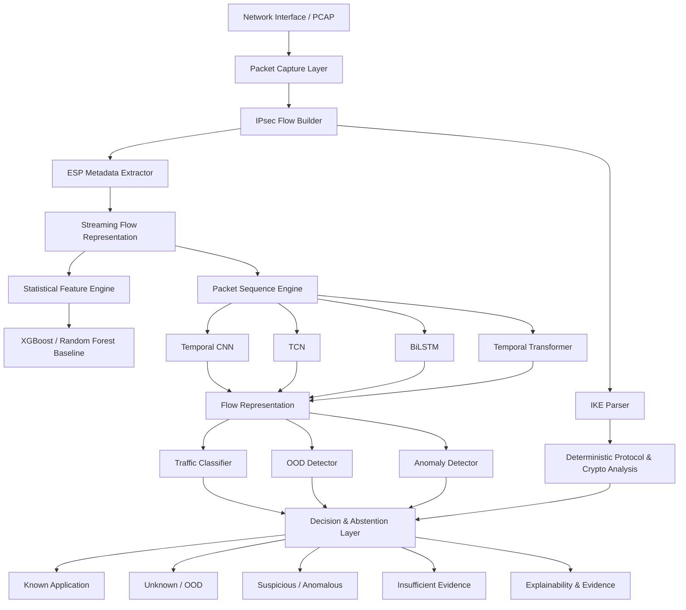
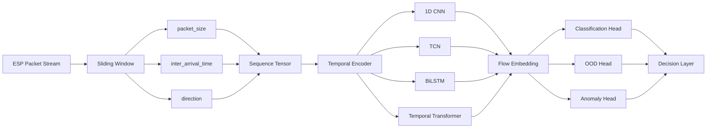
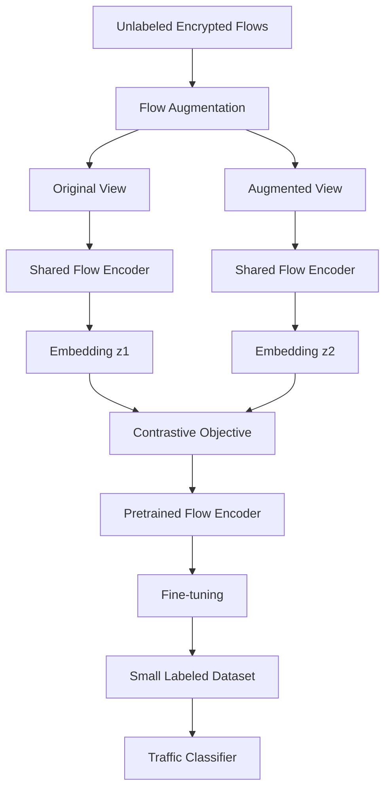
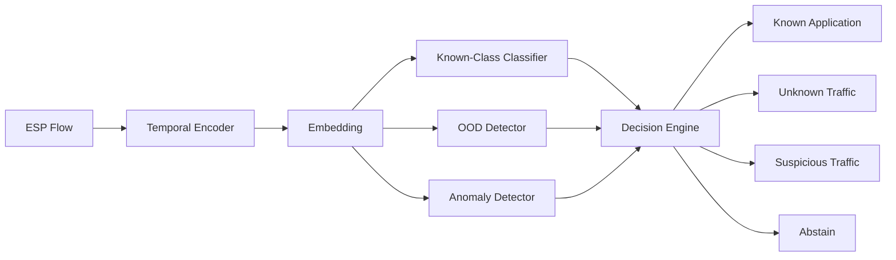
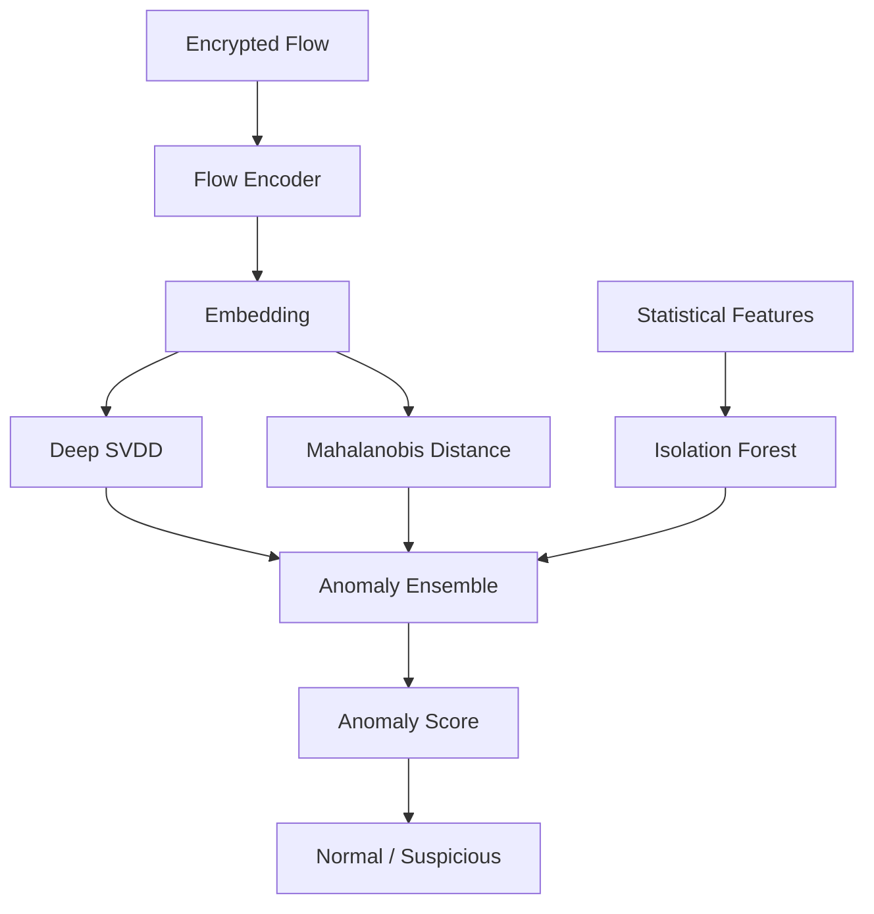
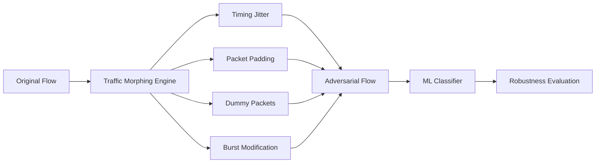
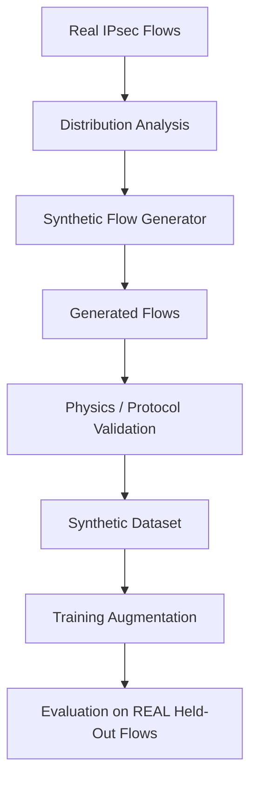
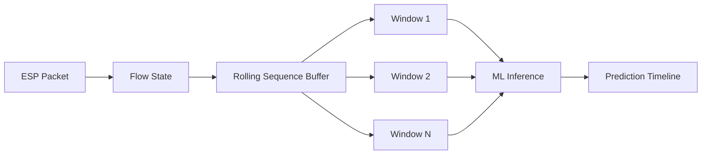
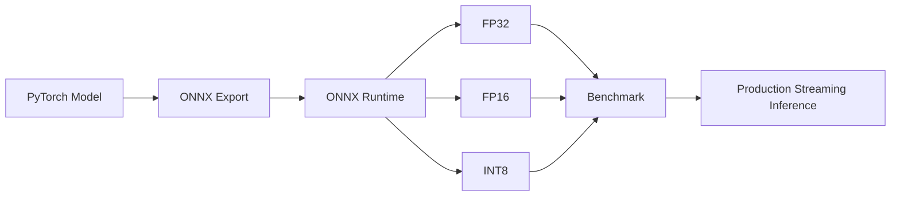
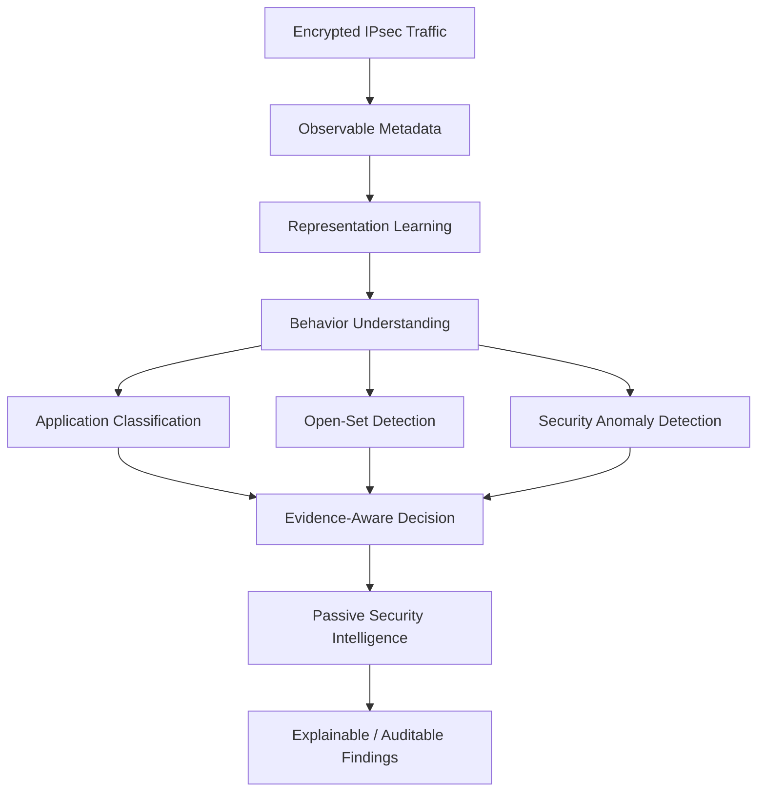

# IPsec Sentinel

### Encrypted IPsec Traffic Intelligence, Open-Set Detection & Security Analytics

IPsec Sentinel is a passive, ML-enhanced security auditing and encrypted traffic intelligence framework for IPsec/IKE VPN networks.

The system follows a strict separation between deterministic protocol analysis and probabilistic machine learning:

> **Facts are parsed. Estimates are inferred.**

IKE control-plane information is analyzed deterministically using protocol rules and security baselines, while encrypted ESP traffic is analyzed exclusively through observable metadata such as packet size, inter-arrival time, directionality, burst patterns, and temporal behavior.

The upgraded architecture extends the original tabular ML pipeline into a research-oriented system supporting:

* Temporal packet-sequence modeling
* Self-supervised representation learning
* Open-set / OOD detection
* Encrypted-flow anomaly detection
* C2 / beacon / exfiltration behavior analysis
* Traffic-morphing robustness evaluation
* Protocol-aware adversarial training
* Synthetic encrypted-flow augmentation
* Cross-network generalization
* Real-time streaming inference
* ONNX / TensorRT optimized deployment
* Evidence-aware classification and abstention

---

## Core Philosophy

```text
                     IPsec Sentinel
                           │
              ┌────────────┴────────────┐
              │                         │
       Deterministic Analysis      ML Inference
              │                         │
          IKE Facts                ESP Estimates
              │                         │
      Protocol / Crypto          Flow Behavior
          Validation             Classification
              │                         │
              └────────────┬────────────┘
                           │
                    Security Decision
```

The system never attempts to decrypt or inspect ESP payload content.

Instead, it learns from the observable structure of encrypted communication.

---

# Architecture

## End-to-End Architecture



---

# ML Architecture

The upgraded ML system uses a multi-model architecture instead of relying exclusively on handcrafted tabular features.



---

# 1. Deterministic IPsec Analysis

The existing protocol analysis remains the source of authoritative facts.

The deterministic layer handles:

* IKE parsing
* Security association inspection
* Encryption algorithm identification
* Integrity algorithm identification
* Diffie-Hellman group analysis
* Authentication configuration
* Crypto-policy validation
* NIST/CERT-In baseline checks
* Security findings

```text
IKE / Control Plane
        │
        ▼
Deterministic Parser
        │
        ├── Encryption
        ├── Integrity
        ├── Authentication
        ├── DH Group
        └── Configuration
                  │
                  ▼
          Security Findings
```

Machine learning does not override deterministic protocol facts.

---

# 2. ESP Flow Representation

ESP payloads remain encrypted.

The ML layer therefore operates on metadata:

```text
Packet
 ├── timestamp
 ├── packet size
 ├── direction
 └── flow identifier
```

A flow is represented as:

```text
[
    [packet_size, inter_arrival_time, direction],
    [packet_size, inter_arrival_time, direction],
    [packet_size, inter_arrival_time, direction],
    ...
]
```

Example:

```text
[
    [512,  0.012,  1],
    [480,  0.018,  1],
    [1180, 0.021, -1],
    [1200, 0.019, -1]
]
```

The sequence can be converted into fixed windows:

```text
N = 64 / 128 / 256 packets
```

with padding and attention masks for short flows.

---

# 3. Feature Engineering

The existing statistical representation is retained as the baseline.

### Packet Statistics

* Minimum packet size
* Maximum packet size
* Mean
* Median
* Standard deviation
* Percentiles
* Packet-size entropy

### Temporal Statistics

* Mean inter-arrival time
* Median IAT
* IAT variance
* Burst duration
* Burst frequency
* Idle periods
* Temporal entropy

### Directional Statistics

* Upload/download ratio
* Direction transition rate
* Direction entropy
* Request/response asymmetry

### Temporal-Spectral Features

The upgraded system can additionally calculate:

* Autocorrelation
* Dominant frequency
* Spectral entropy
* FFT-based periodicity
* Burst periodicity

These features are particularly useful for identifying repetitive behaviors such as beaconing.

---

# 4. Temporal Deep Learning

The original:

```text
Flow statistics → XGBoost
```

pipeline is extended with sequence models.

## 1D CNN

CNN layers learn local temporal patterns:

```text
Packet Sequence
      │
      ▼
Conv1D
      │
      ▼
Conv1D
      │
      ▼
Pooling
      │
      ▼
Flow Embedding
```

Useful for:

* Burst patterns
* Local packet-size transitions
* Short request/response patterns

---

## Temporal Convolutional Network

TCN uses dilated convolutions to capture longer temporal dependencies.


TCN is particularly useful for:

* Periodic traffic
* Long-range burst behavior
* Beacon-like patterns
* Low-latency inference

---

## BiLSTM

BiLSTM captures sequential dependencies across the flow.

```text
Packet Sequence
      │
      ▼
Embedding
      │
      ▼
BiLSTM
      │
      ▼
Attention / Pooling
      │
      ▼
Flow Representation
```

---

## Temporal Transformer

A lightweight Transformer can learn long-range dependencies using attention.

```text
Packet Sequence
      │
      ▼
Feature Projection
      │
      ▼
Positional Encoding
      │
      ▼
Transformer Encoder
      │
      ▼
Attention Pooling
      │
      ▼
Flow Embedding
```

The implementation intentionally uses small models because the initial labeled dataset is limited.

---

# 5. Self-Supervised Learning

A major objective is to reduce dependence on labeled IPsec captures.



Possible protocol-aware augmentations:

* Small timing jitter
* Packet masking
* Sequence cropping
* Subsequence sampling
* MTU-aware size perturbation
* Direction-preserving transformations

Invalid transformations are rejected.

For example:

```text
packet_size <= MTU
IAT >= 0
direction ∈ {-1, +1}
```

The objective is to learn a reusable representation of encrypted traffic before supervised fine-tuning.

---

# 6. Open-Set Recognition

Traditional classifiers assume every test sample belongs to a known class.

IPsec Sentinel instead supports:

```text
Known
Unknown
Suspicious
Insufficient Evidence
```

Architecture:



Candidate OOD methods:

* Mahalanobis distance
* Energy-based scoring
* Deep SVDD
* Evidential Deep Learning
* Embedding-space density estimation

---

# 7. Anomaly Detection

The security ML layer operates independently from application classification.

```text
Application Classification
        ≠
Security Anomaly Detection
```

This allows the system to detect suspicious behavior even when the application itself is unknown.

Potential targets include:

* Periodic C2-like communication
* Covert channels
* Data exfiltration patterns
* Abnormal upload-heavy flows
* Unusual burst behavior
* Unexpected periodic traffic

---

## Anomaly Detection Architecture



---

# 8. Traffic Morphing & Adversarial Robustness

Encrypted traffic classifiers can be affected by:

* Packet padding
* Timing jitter
* Dummy packet injection
* Burst splitting
* Timing manipulation

IPsec Sentinel includes a traffic-morphing evaluation layer.



Adversarial perturbations are constrained by networking requirements:

```text
packet_size <= MTU
IAT >= 0
valid direction
realistic timing
valid packet sequence
```

The system measures:

```text
Clean Performance
        ↓
Morphed Performance
        ↓
Performance Degradation
```

---

# 9. Synthetic Data Generation

Real-world encrypted IPsec captures are difficult to collect because of privacy and operational constraints.

The project therefore supports protocol-aware data augmentation and experimental synthetic generation.

Candidate approaches:

* TimeGAN
* Time-series diffusion
* TabDDPM
* Flow-level generative models



Synthetic data is considered useful only if it improves performance on real unseen data.

Validation includes:

* Packet-size distributions
* IAT distributions
* Burst statistics
* Directionality
* Autocorrelation
* Spectral properties
* ML utility

---

# 10. Domain Generalization

Random train/test splitting can overestimate model performance when samples originate from the same test environment.

IPsec Sentinel therefore supports environment-based evaluation.

```text
Training:

Network A
Network B
Network C

        ↓

       Model

        ↓

Testing:

Network D
```

The test environment remains completely unseen during training.

The testbed can vary:

| Parameter    | Example Values                   |
| ------------ | -------------------------------- |
| MTU          | 576 / 1200 / 1400 / 1500         |
| Latency      | 5 / 20 / 50 / 100 ms             |
| Jitter       | 0 / 5 / 20 ms                    |
| Packet Loss  | 0 / 0.1 / 1 / 5%                 |
| Reordering   | 0 / 1 / 5%                       |
| Bandwidth    | 10 / 50 / 100 / 500 Mbps         |
| Applications | VoIP / HTTP / DNS / Video / Bulk |

This provides a stronger measure of real-world generalization.

---

# 11. Streaming Inference

The ML engine is designed for incremental inference instead of waiting for an entire flow.



Example:

```text
Packet 1–32     → Prediction 1
Packet 33–64    → Prediction 2
Packet 65–96    → Prediction 3
...
```

The flow state maintains:

```text
packet_count
last_timestamp
rolling_statistics
sequence_buffer
current_embedding
prediction_history
OOD_score
anomaly_score
```

---

# 12. Production ML Optimization

The inference stack can be optimized through:



Benchmarks should report:

* p50 latency
* p95 latency
* p99 latency
* Throughput
* CPU utilization
* GPU utilization
* GPU memory
* Model size

The project does not equate model inference throughput with complete 10-Gbps packet-processing capability; end-to-end performance must include capture, flow aggregation, feature extraction, and inference.

---

# 13. Explainability

The system retains explainability for both classical and deep models.

### Classical ML

SHAP provides feature-level explanations:

```text
High contribution:
    constant IAT
    packet-size distribution
    directionality
```

### Deep ML

The system can additionally expose:

* Temporal saliency
* Attention weights
* Important packet windows
* Feature attribution
* OOD distance
* Anomaly score

Example:

```text
Prediction:
    VoIP

Evidence:
    Stable IAT
    Small packet-size variance
    Periodic bidirectional bursts

Confidence:
    0.91

OOD Score:
    Low

Decision:
    Known Application
```

---

# 14. Decision Engine

The final output is not simply:

```text
class = VoIP
```

Instead:

```json
{
  "classification": "VoIP",
  "confidence": 0.91,
  "ood_score": 0.08,
  "anomaly_score": 0.12,
  "decision": "known",
  "abstained": false
}
```

Possible decisions:

```text
KNOWN
UNKNOWN
SUSPICIOUS
ABSTAIN
```

The decision layer combines:

```text
classification confidence
+
OOD score
+
anomaly score
+
minimum observation threshold
```

---

# Project Structure

```text
ipsec-sentinel/
│
├── src/
│   └── ipsec_sentinel/
│       │
│       ├── capture/
│       │   └── ...
│       │
│       ├── parser/
│       │   ├── ike.py
│       │   └── esp.py
│       │
│       ├── features/
│       │   ├── flow.py
│       │   ├── statistics.py
│       │   ├── temporal.py
│       │   └── spectral.py
│       │
│       ├── ml/
│       │   │
│       │   ├── baseline/
│       │   │   ├── xgboost.py
│       │   │   └── random_forest.py
│       │   │
│       │   ├── sequence/
│       │   │   ├── cnn.py
│       │   │   ├── tcn.py
│       │   │   ├── lstm.py
│       │   │   ├── transformer.py
│       │   │   └── encoder.py
│       │   │
│       │   ├── ssl/
│       │   │   ├── augmentations.py
│       │   │   ├── contrastive.py
│       │   │   ├── pretrain.py
│       │   │   └── embeddings.py
│       │   │
│       │   ├── anomaly/
│       │   │   ├── isolation_forest.py
│       │   │   ├── deep_svdd.py
│       │   │   ├── mahalanobis.py
│       │   │   └── ensemble.py
│       │   │
│       │   ├── ood/
│       │   │   ├── energy.py
│       │   │   ├── mahalanobis.py
│       │   │   └── calibration.py
│       │   │
│       │   ├── robustness/
│       │   │   ├── morphing.py
│       │   │   ├── adversarial.py
│       │   │   └── evaluation.py
│       │   │
│       │   ├── deployment/
│       │   │   ├── streaming.py
│       │   │   ├── export_onnx.py
│       │   │   └── benchmark.py
│       │   │
│       │   ├── train.py
│       │   ├── classify.py
│       │   └── explain.py
│       │
│       └── reporting/
│
├── tests/
│   ├── parser/
│   ├── features/
│   └── ml/
│
├── experiments/
│   ├── sequence_models/
│   ├── ssl/
│   ├── ood/
│   ├── anomaly/
│   ├── robustness/
│   └── deployment/
│
├── testbed/
│   ├── docker/
│   ├── strongswan/
│   └── netem/
│
├── configs/
│
├── benchmarks/
│
├── docs/
│   ├── DATASET.md
│   ├── GENERALISATION.md
│   ├── ML_ARCHITECTURE.md
│   ├── OOD.md
│   ├── ROBUSTNESS.md
│   └── DEPLOYMENT.md
│
├── requirements.txt
└── README.md
```

---

# ML Research Roadmap


---

# 4-Week Implementation Plan

## Week 1 — Temporal ML

* Establish reproducible XGBoost baseline
* Implement sequence extraction
* Add packet-size/IAT/direction tensors
* Implement 1D CNN
* Implement TCN
* Compare against baseline
* Add temporal evaluation metrics

## Week 2 — Self-Supervised + OOD

* Implement flow augmentations
* Build contrastive learning pipeline
* Pretrain Flow Encoder
* Fine-tune on labeled captures
* Implement Mahalanobis OOD
* Implement Isolation Forest
* Add explicit abstention

## Week 3 — Security ML

* Implement anomaly detection
* Add periodicity and spectral features
* Build anomaly ensemble
* Implement traffic morphing
* Evaluate padding/jitter/dummy-packet attacks
* Implement constrained adversarial training

## Week 4 — Generalization + Deployment

* Expand strongSwan/netem test matrix
* Create environment-based train/test splits
* Evaluate cross-network generalization
* Export model to ONNX
* Benchmark FP32/FP16/INT8
* Implement sliding-window inference
* Produce final latency/throughput benchmarks
* Document research findings

---

# Evaluation Framework

The project evaluates more than classification accuracy.

## Classification

```text
Macro-F1
Balanced Accuracy
Per-Class F1
Confusion Matrix
Expected Calibration Error
Brier Score
```

## Open-Set Detection

```text
AUROC
AUPR
FPR@95TPR
Detection Error
```

## Anomaly Detection

```text
ROC-AUC
PR-AUC
Precision@K
Recall@K
False Positive Rate
```

## Robustness

```text
Clean Macro-F1
Morphed Macro-F1
Performance Degradation
Attack Success Rate
```

## Deployment

```text
p50 latency
p95 latency
p99 latency
flows/sec
CPU utilization
GPU utilization
GPU memory
Model size
```

---

# Experimental Baselines

Every new ML component should be compared against the original baseline.

```text
                ┌─────────────────┐
                │ XGBoost Baseline│
                └────────┬────────┘
                         │
        ┌────────────────┼────────────────┐
        ▼                ▼                ▼
      CNN               TCN          Transformer
        │                │                │
        └────────────────┼────────────────┘
                         ▼
                SSL Pretrained Encoder
                         │
             ┌───────────┼───────────┐
             ▼           ▼           ▼
           Class        OOD       Anomaly
```

Experiments should use environment-aware splits wherever possible.

---

# Research Questions

The upgraded project investigates:

### RQ1

Can temporal packet-sequence models outperform handcrafted flow statistics for encrypted IPsec traffic classification?

### RQ2

Can self-supervised learning reduce the amount of labeled encrypted traffic required for useful representations?

### RQ3

Can open-set recognition identify previously unseen encrypted traffic instead of forcing every flow into a known class?

### RQ4

Can flow-level behavioral features identify suspicious encrypted communication without inspecting payloads?

### RQ5

How robust are encrypted-traffic models against packet padding, timing jitter, and dummy-packet injection?

### RQ6

Can protocol-aware synthetic augmentation improve generalization to unseen network environments?

### RQ7

Can the resulting models meet practical streaming inference requirements after ONNX/TensorRT optimization?

---

# Security Boundary

IPsec Sentinel is a passive traffic-analysis and security-auditing system.

The ML subsystem:

* Does not decrypt ESP payloads
* Does not inspect application payload content
* Does not reconstruct encrypted application data
* Does not claim semantic knowledge unavailable from metadata
* Reports probabilistic estimates separately from deterministic protocol facts
* Abstains when insufficient evidence is available

The system is designed for defensive security research, network monitoring, auditing, and controlled experimentation.

---

# Current vs Target Architecture

| Capability                  | Existing |       Target |
| --------------------------- | -------: | -----------: |
| IKE deterministic parsing   |      Yes |          Yes |
| Crypto rule analysis        |      Yes |          Yes |
| Handcrafted flow features   |      Yes |          Yes |
| XGBoost/RF                  |      Yes |          Yes |
| SHAP                        |      Yes |          Yes |
| Temporal CNN                |       No |          Yes |
| TCN                         |       No |          Yes |
| BiLSTM                      |       No |     Optional |
| Transformer                 |       No |          Yes |
| Self-supervised learning    |       No |          Yes |
| Open-set recognition        |       No |          Yes |
| OOD detection               |  Limited |          Yes |
| Anomaly detection           |       No |          Yes |
| C2/beacon behavior analysis |       No | Experimental |
| Traffic morphing evaluation |       No |          Yes |
| Adversarial training        |       No |          Yes |
| Synthetic flow generation   |       No | Experimental |
| Cross-network evaluation    |  Limited |          Yes |
| ONNX deployment             |       No |          Yes |
| TensorRT optimization       |       No | Experimental |
| Streaming inference         |  Limited |          Yes |

---

# Project Vision

IPsec Sentinel aims to evolve from a traditional encrypted-traffic classifier into a broader **Encrypted Traffic Intelligence and Security Analytics Platform**.



The long-term objective is not simply to achieve a higher classification score.

It is to build an ML system that can answer:

> **What can we reliably infer from encrypted IPsec traffic, how uncertain are we, and when does observed behavior deviate from what the model has learned?**

---

# Disclaimer

This project is intended for authorized security research, defensive network monitoring, protocol analysis, and controlled laboratory experimentation.

All active testing, traffic generation, adversarial evaluation, and network experiments should be performed only on systems and networks for which the operator has explicit authorization.
